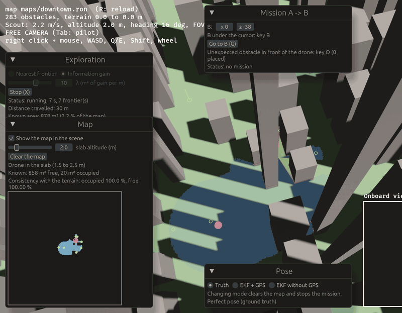

# drone-rust

An autonomous drone simulator in Rust. It provides:

- a 3D world: procedural, hand-drawn, or a city, on sculpted relief, with wind;
- quadrotor flight dynamics: the drone tilts to accelerate, brake and hold against
  the wind;
- drones described in RON, with their sensors;
- an occupancy map built in flight, and a 3D voxel map;
- autonomous exploration;
- A → B navigation on an unknown map;
- a pose estimated by a Kalman filter, corrected by matching the scans on the map;
- a headless benchmark that compares all of this in CSV.

The viewer uses Bevy 0.20 and egui. The core (world, sensors, mapping, planning,
estimation, simulation) does not depend on Bevy, so it also runs from the command line.



## Quick start

Requires Rust 1.98+ (edition 2024).

```bash
cargo run --release -p viewer -- --map maps/downtown.ron
```

Then press `X` to start autonomous exploration. To fly to a goal instead, point at the
ground and press `B` to place it, then press `G` to go there.

For 3D mapping, fly the house map, in its gusty wind:

```bash
cargo run --release -p viewer -- --map maps/house.ron
```

Press `X`, then `V` to hide the real world and see only the voxel map the drone built.

To inspect only the house instead of the whole map: point at it, press `T` to set the
target, then `I`. The drone flies to it, circles it at several heights facing it,
sweeps over its roof, and comes back.
With a 3D lidar the drone flies in 3D: it follows the relief, climbs over the house,
fences and cars, and only goes around what is too tall.

## Viewer

```bash
cargo run -p viewer                                   # procedural world, random seed
cargo run -p viewer -- --seed 42                      # procedural world, fixed seed
cargo run -p viewer -- --map maps/corridor.ron        # hand-drawn map
cargo run -p viewer -- --drone drones/pro.ron         # another drone (default: Mapper)
cargo run -p viewer -- --pose ekf                     # estimated pose: truth, ekf-gps, ekf
```

You can combine options. Bevy is slow in debug builds, so use `--release` in cities.

### Keys

| Context | Keys |
|---|---|
| General | `Tab` pilot ↔ free camera · `[` `]` onboard camera FOV · `N`/`P` next/previous seed (seed mode) · `R` reload the map (file mode) |
| Manual piloting | `W`/`S` forward/backward · `A`/`D` left/right · `Space`/`Shift` up/down · `Q`/`E` yaw |
| Free camera | right click + mouse, `WASD`, `Q`/`E`, `Shift`, wheel |
| Missions | `X` exploration · `B` place B under the cursor · `G` go to B (start/stop) · `O` drop a wall in front of the drone · `T` inspection target under the cursor · `I` inspect (start/stop) |
| 3D map | `M` show/hide the voxel map · `V` show/hide the real world |

### Layout

Blender style: the 3D view in the middle, the settings docked around it, never over it.

- **Left panel**: Inspection (target, status, structure size, exploration limited to a
  radius around the target), Mission A -> B, Exploration, 3D map & flight, Wind, Pose,
  Airframe (battery, ground effect, thrust of each motor, and a health slider per
  motor to make one fail in flight).
- **Right panel**: onboard view (the camera is fixed to the airframe, so the horizon
  tilts when the drone does), Map (top-down occupancy grid and its consistency with the
  terrain), Sensors (latest measurements, gimbal or fixed mount, latency, noise
  controls; the GPS shows its accuracy, or "no fix" when buildings mask the sky).
- **Top right of the 3D view**: telemetry as text: speed, altitude, heading, pitch,
  roll, thrust, wind felt.
- **Status bar**: world source and the keys of the current mode.

Sections collapse, and both panels can be resized by dragging their edge.

## Maps

| File | Bench name | Content |
|---|---|---|
| `maps/corridor.ron` | `corridor` | Corridor of walls, poles and a rotated block; 80 m |
| `maps/downtown.ron` | `downtown` | Tight orthogonal grid, tall buildings, towers, squares |
| `maps/suburbs.ron` | `suburbs` | Low scattered houses, gardens and parks; grid rotated by 15° |
| `maps/old_town.ron` | `old-town` | Grid at 35°, skewed and offset buildings, gentle terrain |
| `maps/dense_city.ron` | `dense-city` | 160 m, 3.5 m streets: the hardest one |
| `maps/house.ron` | — | A house (open door, upper floor, gable roof, porch) and a large L-shaped building (ground-level passage, penthouse), on hills, in a gusty wind |
| — | `seedN` | Procedural world of seed N (e.g. `seed42`) |

A map is a `WorldSpec` in RON. The frame has Y up, the origin at the center, and units in meters.
The drone takes off from the origin.

```ron
WorldSpec(
    size_m: 80.0,
    cell_m: 1.0,
    terrain: Flat(height: 0.0),            // or Noise(..), or Landscape(..)
    wind: (speed_ms: 4.0, from_deg: 250.0, gust_ms: 3.0, turbulence_ms: 0.8),  // optional
    obstacles: List([
        (shape: Box(size: (0.5, 4.0, 30.0)), x: -4.0, z: -20.0),
        (shape: Cylinder(radius: 0.4, height: 6.0), x: 10.0, z: 5.0),
        (shape: Box(size: (5.0, 8.0, 3.0)), x: -15.0, z: 12.0, yaw_deg: 30.0),
        (shape: Roof(size: (6.0, 2.0, 4.0)), x: -15.0, z: 12.0, yaw_deg: 30.0, elevation_m: 8.0, material: Glass),
    ]),
)
```

- `Landscape` is a noise terrain sculpted by `features`: `Hill` (a negative height
  digs a hollow) and `Pad`, a flat platform for a building.
- `elevation_m` lifts an obstacle above the ground: lintels, floor slabs, roofs,
  canopies, bridges.
- `Roof` is a gable roof, ridge along its length.
- `material` (default `Concrete`) changes how lidars and depth cameras see a surface:
  `Glass` lets 70 % of the rays through, `Dark` only answers within 35 % of the range
  and loses some returns even there, `Metal` is three times noisier and sometimes
  echoes from behind itself, `Foliage` returns from up to 1 m inside the canopy.
  Sonars hear every material alike. In generated cities, 40 % of the towers are glass,
  a few buildings dark or metal, and the trees foliage; the house map has metal cars
  and poles, a dark car, a glass roof and leafy canopies.
- The wind (`from_deg`: where it comes from, 0 = north) grows with height, comes in
  gusts that travel downwind, carries turbulent eddies, and drops in the lee of
  obstacles, where it gets gustier.

`obstacles` also accepts `None`, `Random(..)` and `City(..)`. A city is generated from a few
parameters:

- block and street size, lots per block and alley width;
- building heights and density;
- park and tower probability;
- grid rotation and old-town disorder (`jitter_deg`, `jitter_m`);
- a cleared square at the start.

See the commented `maps/*.ron` files and `crates/world/src/city.rs`.

## Drones

| File | Profile | Sensors |
|---|---|---|
| `drones/scout.ron` | light, fast (8 m/s) | 2D lidar 360 rays 12 m, forward sonar, IMU, barometer |
| `drones/heavy.ron` | heavy, slow (5 m/s), 0.4 m radius | depth camera, downward sonar, IMU, barometer |
| `drones/cheap.ron` | low-end (4 m/s) | 4 sonars, low-grade IMU, barometer |
| `drones/pro.ron` | high-end (8 m/s) | 2D lidar 720 rays 20 m, depth camera, sonar, good IMU, barometer, GPS |
| `drones/mapper.ron` | 3D mapping (6 m/s), viewer default | 3D lidar 16 × 360 rays 25 m, sonar, IMU, barometer, GPS |

A `DroneSpec` describes:

- the airframe: mass, max speed and acceleration, max yaw rate, radius, and
  optionally its dynamics: thrust-to-weight, max tilt and tilt rate, attitude and
  motor time constants, linear and quadratic drag, rotor radius (ground effect,
  default 0.4 × radius) and a `battery` (capacity, full and empty voltage, internal
  resistance; none: endless energy);
- the onboard camera;
- a list of sensors, each with its mount, rate and `latency_s` (default 0: the
  measurement keeps its capture time but arrives late).

A mount is `stabilized` by default (on a gimbal: it only follows the heading).
`stabilized: false` fixes the sensor to the airframe: it tilts when the drone
accelerates, and a 2D lidar then sees the ground or the sky. The Mapper's and the
Pro's lidars are fixed.

The sensor types are `Lidar2D`, `Lidar3D`, `Sonar` and `Depth` for perception, and
`Imu`, `Baro` and `Gps` for navigation. Noise, dropouts and biases are configurable per
sensor. A sonar's `multipath` (0 to 1, 0.3 on the Cheap, Heavy and Pro) is the chance
that an echo off an oblique surface bounces off a second one first and reads too far.

## Benchmark

The benchmark is a headless binary. It runs in parallel on all cores and is
deterministic (fixed seed and fixed step).

```bash
cargo run --release -p bench
```

```bash
cargo run --release -p bench -- --drones scout,pro --maps corridor,downtown --missions explore-nearest,a-b --poses truth,ekf-gps --seeds 1,2 --out bench/results.csv
```

| Option | Default | Values |
|---|---|---|
| `--drones` | all | `scout`, `heavy`, `cheap`, `pro`, or a `.ron` path (e.g. `drones/mapper.ron`) |
| `--maps` | all | names from the map table, `seed42`, `seed7`, any `seedN`, or a `.ron` path |
| `--missions` | all | `explore-nearest`, `explore-infogain`, `a-b` |
| `--poses` | all | `truth`, `ekf-gps`, `ekf` |
| `--seeds` | `1` | list of seeds |
| `--explore-limit` | `1200` | max duration of an exploration, s |
| `--a-b-limit` | `120` | max duration of an A → B, s |
| `--threads` | number of cores | |
| `--out` | `bench/results.csv` | |
| `--scan-match` | `on` | `on`, `off`: in `ekf` mode, correct the pose by scan matching |

**Success criteria:**
- **Exploration**: finished, with no collision, at least 90 % coverage, and at least
  90 % of the occupied cells correct.
- **A → B**: the *true* position ends within 1 m of B, with no collision.

The CSV has one row per simulation. Besides success, it records time, distance,
collisions, coverage at 60 s, 180 s and at the end, map correctness (occupied and free),
pose error (RMS and max), compute time per step (mean and max), electrical energy drawn
and final battery charge (`energy_wh`, `soc_end`), and the mean share of the sky masked
by buildings along the flight (`sky_masked`: GPS satellites lost).

## Results

The full matrix has 4 drones × 7 maps × 3 missions × 3 pose modes = 252 runs, with
seed 1 and the default limits, on the current code: quadrotor dynamics and wind,
a fixed lidar on the Pro, lidar sweep and deskew, materials, sonar multipath and GPS
masked by buildings. The raw data is in [`bench/results.csv`](bench/results.csv).

### Success by mission and pose mode

| Mission | `truth` | `ekf-gps` | `ekf` |
|---|---|---|---|
| A → B | 25/28 | 9/28 | 11/28 |
| Exploration, nearest frontier | 9/28 | 2/28 | 0/28 |
| Exploration, information gain | 8/28 | 5/28 | 0/28 |

### Perfect pose (`truth`), by drone

| Drone | A → B | Exploration (both strategies) | Collisions |
|---|---|---|---|
| Scout | 6/7 | 7/14 | 0 |
| Pro | 6/7 | 8/14 | 4 |
| Heavy | 6/7 | 2/14 | 9 |
| Cheap | 7/7 | 0/14 | 0 |

### GPS (`ekf-gps`), by map

Median RMS pose error over the 12 runs of each map, and mean share of the sky masked
by buildings along the flights.

| Map | Pose error | Sky masked |
|---|---|---|
| `seed42`, `seed7` | 0.47–0.49 m | 5–8 % |
| `corridor` | 0.54 m | 10 % |
| `suburbs` | 0.63 m | 16 % |
| `old-town` | 2.0 m | 52 % |
| `dense-city` | 2.3 m | 60 % |
| `downtown` | 2.5 m | 66 % |

### Pose error without GPS (`ekf`, with scan matching), by drone

Median RMS error over the 21 runs of each drone. Scan matching needs a lidar or a
depth camera; the Cheap only has sonars.

| Drone | Pose error | A → B |
|---|---|---|
| Scout | 2.7 m | 5/7 |
| Pro | 3.9 m | 5/7 |
| Heavy | 26 m | 1/7 |
| Cheap | 64 m | 0/7 |

### Takeaways

- **A → B with a perfect pose holds up**: 25/28, as before the dynamics and the
  sensor realism.
- **Explorations often run out of time.** 37 of the 56 perfect-pose explorations
  end on the 1200 s limit. A drone that has to tilt to accelerate and to brake, and
  waits for its response time, flies the same paths more slowly.
  - The maps they leave are right (median 100 % of the occupied cells correct for
    the lidar and depth drones), and the Scout and the Pro cover 99 % in the median.
  - Collisions with a perfect pose are down to 13 contacts in 4 runs (124 before two
    fixes). Avoidance no longer holds a drone that drifts slowly into a wall: before,
    it copied the drift and one Scout run in downtown stayed pressed against a
    facade for 71 contacts. And the map keeps glass: a cell that returns at least one
    optical echo for four passes holds matter, so the 70 % of beams crossing a pane
    no longer erase it. What remains is the Heavy, with only a forward depth camera,
    reaching the corner of a glass tower before it has seen enough of it.
- **In the cities, the GPS is no longer enough.** With half or more of the sky
  masked, the median pose error goes from about 0.5 m in the open to 2–2.5 m, and
  A → B with GPS falls to 9/28: an error of two meters puts B in the wrong street.
  In the open maps, the GPS keeps the error around half a meter.
- **Without GPS, scan matching still holds the lidar drones to a few meters**
  (2.7–3.9 m in the median), and A → B reaches 11/28, more than with a GPS in the
  cities. No exploration succeeds without GPS: an error of a meter or two is enough
  to fail the 90 % map criterion.
- **Sonars are not enough.** With a perfect pose the Cheap never collides, but it
  covers about a fifth of the free space. Without GPS nor scan matching its pose
  drifts to tens of meters and it hits real walls it believes elsewhere (258 contacts
  with an estimated pose).
- **Compute is cheap.** One step (estimation + map + decision; the sensors are not
  counted) takes 0.26 ms in the median and at most 1.1 ms on average for a run.

## Architecture

The project is a Cargo workspace with one crate per layer:

| Crate | Role |
|---|---|
| `world` | Terrain and relief, obstacles (boxes, cylinders, roofs) and their materials, raycasts and contacts (8 m grid spatial index), procedural cities, wind field, quadrotor flight dynamics |
| `drone_spec` | RON description of a drone, with validation |
| `sensors` | 2D and 3D lidar (sweeping), sonar (multipath), depth camera, with material responses; noisy IMU, barometer, and GPS masked by buildings; mounts, latency; rays cast in parallel |
| `mapping` | 2D occupancy grid: ray casting, per-cell hit/miss evidence, ambiguous cells; scan-to-map matching (point-to-plane ICP); sparse 3D voxel map (3D DDA, integrated in parallel, change tracking per 16³ chunk); lidar deskew |
| `planning` | Frontiers, exploration (nearest / information gain), incremental D* Lite, timed trajectory, safe-speed control |
| `estimation` | 11-state EKF (position, velocity, yaw, accelerometer and gyro biases) on IMU + barometer + GPS + scan matching |
| `sim` | Headless simulation (drone + sensors + estimation + map), shared by tests and the bench |
| `bench` | Benchmark matrix → CSV |
| `viewer` | Bevy application |

### Key ideas

- **Quadrotor dynamics.** The drone only pushes along its thrust axis.
  - The pilot (or the planner) commands a velocity. A PI loop turns the error into
    a wanted acceleration, plus a feed-forward of the still-air drag. Its integral
    learns the steady push of the wind, so the drone ends up leaning into it.
  - The thrust axis turns towards the wanted one with a lag and a bounded tilt rate,
    and the motors follow with their own lag: braking first means swinging the tilt
    to the other side.
  - Drag acts on the airspeed (velocity relative to the wind). A gale stronger than
    the tilt limit allows wins.
  - Obstacles push the drone back out and absorb most of the impact.
  - The physics runs in 2 ms sub-steps, whatever the outer step.
  - Four motors in an X, each with its own lag and limit: the mixer gives priority to
    the thrust, then to the attitude, and the attitude follows from the torques. A
    motor can be weakened or killed in flight.
  - Close to the ground, the rotors push harder (ground effect); the linear drag only
    acts in the rotor plane (induced rotor drag).
  - With a battery, the voltage sags with the charge and the current, and the
    available thrust with it.
- **Sensor realism.**
  - A sensor is on a gimbal (heading only) or fixed to the airframe; the onboard
    camera always tilts with the airframe.
  - A spinning lidar fires its rays along its sweep, from wherever the drone is at
    that instant: moving or turning, it sees a distorted scan. The measurement keeps
    the pose at the start of the sweep, and the maps and the scan matching put each
    ray back where it was fired from (deskew).
  - Measurements can arrive late; each keeps its capture time and pose.
  - Materials, sonar multipath and GPS masking: see *Maps* and *Drones*. The GPS
    looks for 16 satellites spread over the sky: the share that buildings mask
    worsens its accuracy (up to ×10), adds a slow multipath bias, and below four
    satellites there is no fix. Each fix carries its accuracy, which the EKF uses.
- **Performance.** Lidar and depth rays are cast in parallel (rayon), each with its
  own noise generator so that a run stays deterministic, and the voxel rays are traced
  in parallel then applied in order. Hash maps use FxHash. The viewer remeshes only the
  16³ chunks of the voxel map that changed. A ray above the highest point of the relief
  skips the terrain march (about 40 % off a raycast in a city). A bounding volume
  hierarchy was tried for the obstacles and dropped: no faster than the 8 m grid index.
- **Inspection of one structure** (needs 3D flight).
  - From the target point, the structure is found in the drone's own 3D map: the
    voxel columns standing more than 1 m out of the local ground, connected to the
    point. Its footprint grows as the drone discovers its far side, and the plan
    follows.
  - Plan: a ring 4 m around the footprint near the ground, another at mid-height
    for a tall structure, then two passes 3 m over the roof. The drone faces the
    structure all along.
  - A waypoint inside something (a tree on the ring) is moved outwards, or skipped;
    climbs and descents stay in the free gap above and below the body.
- **Exploration of an area.** The explorer can be limited to a disk: frontiers
  outside are ignored, and it is done when the disk is.
- **Safe speed accounts for the response time.** The stopping distance includes the
  0.2 s the airframe needs before it decelerates, and the look-ahead covers a full stop
  from top speed.
- **3D map.** Every lidar or depth ray frees the voxels it crosses and marks the one
  it hits, in a sparse hash map: facades, roofs, overhangs, the relief.
- **3D flight** (viewer default for a drone with a 3D lidar).
  - The voxel map is projected onto the 2D planning grid: only obstacles taller
    than `max_overfly_m` (12 m) above their ground block; the 2D planners are
    unchanged.
  - The target altitude is the highest surface under and ahead of the drone (ground,
    roofs, canopies) plus a clearance (2.5 m): it follows the relief and climbs over
    obstacles, then comes back down slowly.
  - Whatever still stands at the drone's height caps its horizontal speed: it
    waits to have climbed before going on.
- **Optimistic planning.** Unknown cells are assumed free.
  - When the map reveals an obstacle, D* Lite repairs the path instead of starting
    over.
  - The configuration space is inflated by the drone's radius plus a margin, and the
    inflation is updated incrementally.
- **Timed trajectory.** The speed profile is computed forward and backward under an
  acceleration limit. In corners, the speed drops according to the allowed deviation.
- **Safe speed.** At every step, the speed towards each nearby obstacle is capped so
  that the drone can stop before reaching it. The margin is wider for occupied cells
  than for unknown ones.
- **Exploration.**
  - Frontiers lie between free and unknown cells.
  - The drone does a 360° scan before declaring the map finished.
  - Ambiguous cells are not frontiers. These are cells with contradictory evidence,
    usually seen at grazing angles.
- **Noisy pose.** In `ekf` and `ekf-gps` modes, the map is built in the *estimated*
  pose, so EKF drift shows up directly as a wrong map.
- **Scan matching.** Each lidar or depth scan is aligned on the map before being
  added to it, and the result corrects the EKF as a pose measurement (x, z, yaw).
  - Point-to-plane ICP: a scan endpoint is pulled across the wall it hits, never
    along it, so a corridor constrains the pose across, not along. Poles and
    corners give point-to-point constraints.
  - The map remembers where the hits fell inside each cell. Matching on cell
    centers instead biases each match by up to half a cell, and the bias feeds back
    into the map.
  - Only hits within 70 % of the sensor range are used: the map knows walls up to
    the range of the previous scans, and the far hits would pull the pose backwards.
  - The Hessian of the fit gives the measurement covariance. After a stretch with
    nothing to match, the search widens to 3σ of the pose uncertainty to lock on again.

## Tests

```bash
cargo test --workspace --release
```

```bash
cargo clippy --workspace --all-targets
```

There are about a hundred tests, for example:

- D* Lite against Dijkstra, and after an incremental repair;
- full A → B missions, including a wall that appears in flight and an enclosed goal;
- the EKF: a perfect IMU gives the exact pose, the GPS keeps the error low, and the
  biases are recovered;
- scan matching: a pose offset is recovered within its covariance, and a scan along a
  corridor does not slide;
- the indexed raycast against a brute-force one;
- the shipped maps all build;
- flight dynamics: nose down to accelerate, nose up to brake, holding still in a
  steady wind by leaning into it, drifting in a gale, bouncing off a wall;
- a 3D lidar circling a house maps its walls and roof, with no voxel in the air;
- the Mapper flies around the house, in its gusty wind, without touching anything;
- 3D flight: over a low wall, around a 25 m one, along a hill, over the house roof,
  never closer than 1.5 m to the ground;
- inspection: the house is found with its real size, all four walls and the roof are
  mapped, the far building is never approached, and the drone comes back home; on
  the house map, in the wind, with no contact;
- an exploration limited to 10 m stops there;
- sensors: a fixed lidar on a pitched drone hits the ground, a late measurement
  arrives late with its capture time, a sweep while turning is distorted and deskew
  undoes it;
- materials: glass lets most rays through, dark surfaces only answer up close, metal
  echoes behind itself, leaves scatter; a sonar echo off an oblique floor bounces;
  a wall degrades the GPS fix and a canyon loses it.

## Known limitations

- Without GPS, the pose only holds where scans see structure: in open areas or
  along featureless corridors, the IMU drift takes over.
- The Cheap drone's sonars miss walls seen at an angle.
- 3D flight goes over obstacles, never under them (porch, passage): the projection
  keeps only the top of each column. Without a 3D lidar, planning stays on the 2D slab.
- A facade seen from below looks short: the drone climbs along it until it sees it
  is too tall, then goes around.
- The wind's shelter is a single upwind raycast: no flow around buildings.
- Scan matching is scan-to-map without loop closure: an error made while
  exploring is written into the map and never undone.
- The EKF knows the tilt exactly (it reads it from the simulation). A strapdown IMU
  with an error-state filter estimating the tilt, with rotor drag fusion and wind
  estimation, was tried and set aside: without GPS it lost missions the current filter
  wins, because the scan matching, done on a map written from the same drifting
  estimate, then confirms the drift and hides the tilt error behind it.
- Fixed-mount 2D lidars see the ground when the drone tilts: without GPS, the Pro and
  the Mapper match fewer points and drift more than with a gimbal.

## License

Licensed under either of

- Apache License, Version 2.0 ([LICENSE-APACHE](LICENSE-APACHE))
- MIT license ([LICENSE-MIT](LICENSE-MIT))

at your option.

Unless you explicitly state otherwise, any contribution intentionally submitted for
inclusion in this project, as defined in the Apache-2.0 license, shall be dual licensed
as above, without any additional terms or conditions.
